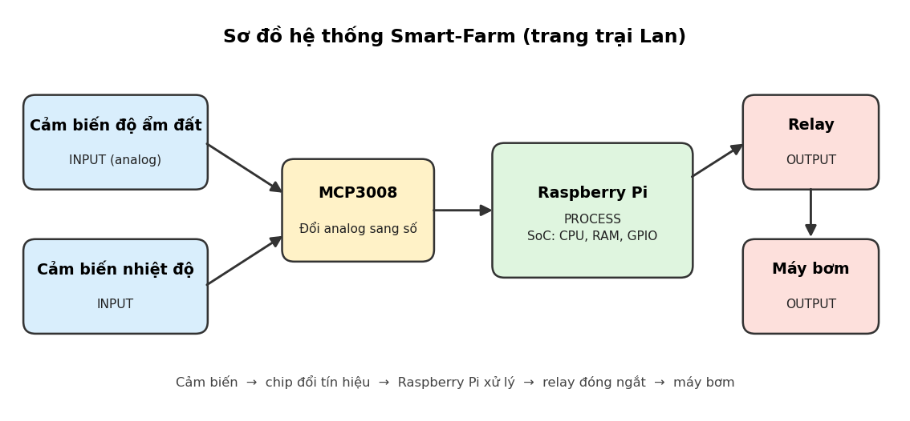

# 🚀 Smart-Farm: Tưới tự động cho trang trại Lan

## Mô tả

Smart-Farm là hệ thống tưới nước *tự động* dành cho vườn của chị Lan. Cảm biến đo độ ẩm đất, một bo mạch Raspberry Pi đọc số đo rồi quyết định có bơm hay không. Người nông dân **không cần canh vườn**, chỉ cần kiểm tra thiết bị theo danh sách ở mục Tính năng.

Hệ thống chạy theo ba bước quen thuộc: đo, xử lý, hành động. Bên dưới là sơ đồ các bộ phận và cách chúng nối với nhau.



> Nếu ảnh không hiện, hãy kiểm tra mạng. Sơ đồ đọc từ trái sang phải: cảm biến, chip đổi tín hiệu `MCP3008`, Raspberry Pi, relay, máy bơm.

## Hướng dẫn cài đặt

Mọi dòng trong khung dưới đây là lệnh gõ vào Terminal của Raspberry Pi. Gõ từng dòng, chờ chạy xong rồi mới gõ dòng kế tiếp.

### Bước 1. Tải mã nguồn và bật SPI

```bash
git clone https://github.com/TEN_BAN/smart-farm.git
cd smart-farm
sudo raspi-config nonint do_spi 0
sudo reboot
```

Thay `TEN_BAN` bằng tên tài khoản GitHub chứa dự án. Máy sẽ khởi động lại sau lệnh cuối.

### Bước 2. Cài thư viện

```bash
sudo apt update
sudo apt install -y python3-gpiozero python3-spidev
```

### Bước 3. Chương trình điều khiển

Lưu đoạn sau vào file `bom_tuoi.py` trong thư mục `smart-farm`.

```python
import logging
from logging.handlers import RotatingFileHandler
from time import sleep
from gpiozero import MCP3008, OutputDevice

NGUONG_KHO = 0.65      # trên mức này: đất khô (thang 0 đến 1)
THOI_GIAN_BOM = 20     # giây bơm mỗi lần
CHU_KY_DO = 60         # giây giữa hai lần đo

# Nhật ký ghi ra file, tối đa 1 MB mỗi file, giữ 3 file cũ
nhat_ky = logging.getLogger("smart_farm")
nhat_ky.setLevel(logging.INFO)
bo_ghi = RotatingFileHandler("smart_farm.log", maxBytes=1_000_000, backupCount=3, encoding="utf-8")
bo_ghi.setFormatter(logging.Formatter("%(asctime)s %(message)s"))
nhat_ky.addHandler(bo_ghi)

cam_bien = MCP3008(channel=0)
may_bom = OutputDevice(17, active_high=False, initial_value=False)

try:
    while True:
        gia_tri = cam_bien.value
        nhat_ky.info("Độ khô: %.2f", gia_tri)

        if gia_tri > NGUONG_KHO:
            nhat_ky.info("Đất khô, bật máy bơm")
            may_bom.on()
            sleep(THOI_GIAN_BOM)
            may_bom.off()

        sleep(CHU_KY_DO)
except KeyboardInterrupt:
    may_bom.off()
    nhat_ky.info("Đã dừng, máy bơm tắt")
```

### Bước 4. Chạy thử

```bash
python3 bom_tuoi.py
```

Muốn dừng, nhấn `Ctrl+C`. Chương trình tắt bơm trước khi thoát.

## Tính năng

- [x] Đọc độ ẩm đất mỗi 60 giây
- [x] Tự bật máy bơm khi đất khô hơn `NGUONG_KHO`
- [x] Tự tắt máy bơm sau 20 giây
- [x] Dừng an toàn bằng `Ctrl+C`
- [x] Ghi nhật ký ra file `smart_farm.log` có giới hạn dung lượng
- [ ] Ghi nhiệt độ vào nhật ký
- [ ] Gửi cảnh báo về điện thoại khi máy bơm chạy quá nhiều lần trong ngày

## Bảng thông số

| Hạng mục | Giá trị | Ghi chú |
|---|---|---|
| Bo mạch chính | Raspberry Pi | Chip SoC có sẵn CPU, bộ nhớ và chân GPIO |
| Chip đổi tín hiệu | `MCP3008`, kênh 0 | Đổi tín hiệu analog của cảm biến sang số |
| Chân điều khiển relay | `GPIO17` | Relay đóng thì máy bơm chạy |
| Ngưỡng đất khô | `NGUONG_KHO = 0.65` | Hiệu chuẩn lại theo đất thật |
| Thời gian bơm mỗi lần | 20 giây | Biến `THOI_GIAN_BOM` |
| Chu kỳ đo | 60 giây | Biến `CHU_KY_DO` |
| Dung lượng nhật ký | 1 MB mỗi file, giữ 3 file cũ | Tự xoay vòng, không đầy ổ |

## Hệ thống nghĩ và làm thế nào

### SoC: một con chip làm nhiều việc

Raspberry Pi dùng SoC (System on Chip, hệ thống trên một chip). CPU, bộ điều khiển bộ nhớ và các cổng GPIO, SPI nằm chung một chip. Nhờ vậy bo mạch nhỏ, gọn, ít dây nối và tiết kiệm điện, rất hợp để đặt ngoài vườn.

### IPO: ba bước của hệ thống

| Bước | Trong Smart-Farm |
|---|---|
| Input (đầu vào) | Số đọc độ ẩm và nhiệt độ từ cảm biến |
| Process (xử lý) | Raspberry Pi so số đọc với `NGUONG_KHO` |
| Output (đầu ra) | Relay đóng hoặc mở, máy bơm chạy hoặc dừng |

### Khi CPU nhận lệnh tưới cho vườn Lan

CPU xử lý mỗi lệnh theo chu kỳ Fetch, Decode, Execute:

> **1. Fetch (nạp lệnh):** CPU lấy lệnh kế tiếp từ RAM. Ở đây là lệnh "bật máy bơm cho vườn Lan".
>
> **2. Decode (giải mã):** CPU dịch lệnh ra việc cụ thể: đưa chân `GPIO17` sang mức điện áp điều khiển relay.
>
> **3. Execute (thực thi):** CPU đổi mức điện áp trên `GPIO17`. Relay đóng, máy bơm chạy. Xong việc, CPU quay lại bước 1 với lệnh tiếp theo.

### DIKW: từ con số đến hành động

Con số nhiệt độ đi qua bốn tầng trước khi thành việc tưới:

```text
            [     WISDOM     ]
        [       KNOWLEDGE        ]
    [          INFORMATION           ]
[                  DATA                  ]
```

Đọc từ đáy lên đỉnh. Các con số dưới đây chỉ là ví dụ minh họa.

1. DATA (dữ liệu): cảm biến báo `38` độ C lúc 12 giờ trưa. Đây mới là con số thô.
2. INFORMATION (thông tin): 38 độ vào buổi trưa là nóng hơn mức bình thường của vườn.
3. KNOWLEDGE (tri thức): trời nóng thì nước trong đất bốc hơi nhanh, đất sẽ khô sớm hơn lịch dự kiến.
4. WISDOM (hành động khôn ngoan): nếu độ ẩm đã chạm ngưỡng thì bơm ngay, còn chưa chạm thì chờ chiều mát để đỡ hao nước.

## Lưu ý

### Khi RAM đầy vì nhật ký

Giả sử nhật ký bị dồn trong RAM quá lâu và Raspberry Pi chậm hẳn hoặc đứng. Hãy xử lý theo đúng thứ tự sau, đừng đảo bước.

1. Ngắt nguồn máy bơm bằng công tắc riêng hoặc khóa van nước trước tiên. Đừng chờ chương trình tự tắt bơm, vì lúc Pi đứng nó có thể không kịp.
2. Kiểm tra bộ nhớ và ổ đĩa để biết đúng nguyên nhân:

   ```bash
   free -h
   df -h
   ls -lh smart_farm.log*
   ```

3. Dừng chương trình đang chạy:

   ```bash
   pkill -f bom_tuoi.py
   ```

4. Giữ lại nhật ký cũ để xem sau, đừng xóa ngay:

   ```bash
   mv smart_farm.log ~/nhat-ky-cu.log
   ```

5. Khởi động lại Pi bằng `sudo reboot`. Không rút điện đột ngột, vì dễ làm hỏng thẻ nhớ.
6. Chạy lại `python3 bom_tuoi.py` rồi kiểm tra bằng `free -h` sau vài phút. Dung lượng RAM đã dùng phải ổn định.

Phiên bản chương trình trong README này đã ghi nhật ký ra file bằng `RotatingFileHandler`, không giữ trong RAM, nên mỗi file không vượt quá 1 MB. Đừng đổi lại thành việc gom nhật ký vào một biến danh sách.

### Ký tự đặc biệt khi chỉnh README

Muốn hiện dấu sao hoặc dấu thăng nguyên dạng ngoài khối code, đặt dấu `\` phía trước, ví dụ `\*` và `\#`.
# HCM_CNTT1_LAMHUUNGHI_nhapmonCNTT_SESSION10_EX05
